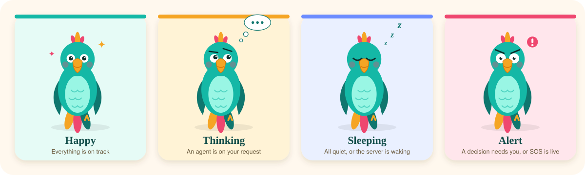
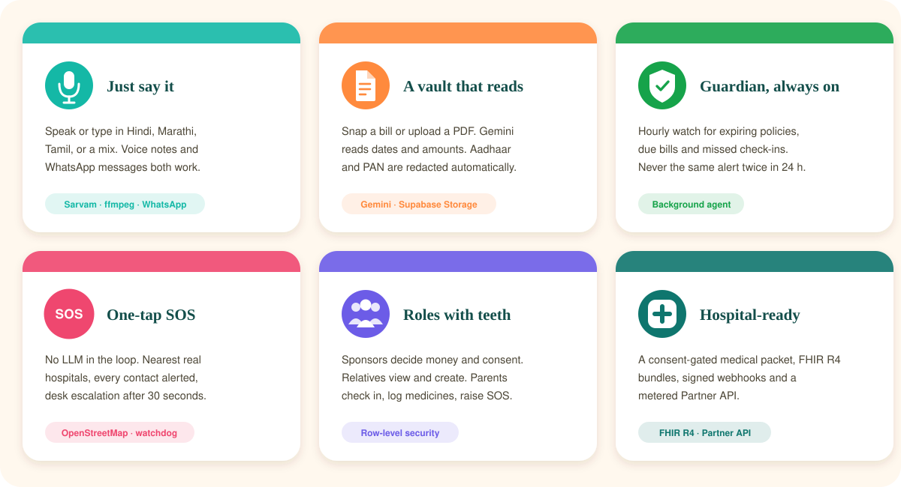
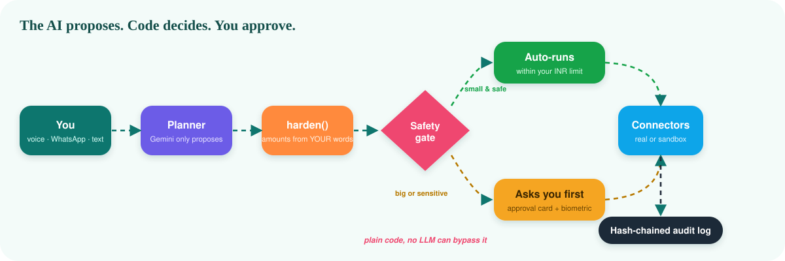
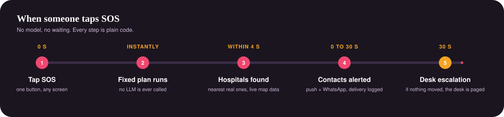

<div align="center">



<br/>


**[The idea](#-the-idea)** · **[Meet Mitthu](#-meet-mitthu)** · **[Features](#-what-it-does)** · **[How it thinks](#-how-it-thinks)** · **[SOS](#-when-seconds-matter)** · **[Run it](#-run-it)** · **[Deploy](#-deploy)** · **[Honest status](#-honest-status)**

</div>


## 🌙 The idea

> It is **2:00 AM in San Francisco**. Your father in Pune has chest pain. The insurance papers are somewhere in a drawer, your mother is panicking, and the nearest relative is 40 km away.

**Aangan** (आँगन, the open courtyard at the heart of an Indian home) is a care platform for Non-Resident Indians. Agents do the legwork at home: booking, reminding, fetching, summarising, escalating. **You never lose the steering wheel.** Money, medical consent and sharing are guarded by plain code that no AI can talk its way past.

<table>
<tr>
<td align="center" width="33%"><h3>🤖 Agents act</h3>They book, remind, read documents and raise the alarm, in your parents' language.</td>
<td align="center" width="33%"><h3>🛡️ Code guards</h3>Spending limits, consent and masking are enforced deterministically, never by a prompt.</td>
<td align="center" width="33%"><h3>👤 You decide</h3>Anything big or sensitive lands on your phone as an approval card.</td>
</tr>
</table>


## 🦜 Meet Mitthu

Every screen is hosted by **Mitthu**, a parrot who lives in the courtyard. He is the app's face and its mood. You always know at a glance how things stand at home.



The palette is marigold, teal and ivory, with a proper dark theme. **Senior mode** gives parents a big-type, one-thumb version of the app.


## ✨ What it does



<details>
<summary><b>🧰 …and the rest of the courtyard</b></summary>

<br/>

| | |
|---|---|
| ☁️ **Live weather** | Open-Meteo for the parent's city, shown in the Home screen's sky clock |
| 🔔 **WhatsApp alerts** | Honest delivery status: `sent`, `failed: <reason>` or `not configured` |
| 🧾 **Tamper-evident audit** | Hash-chained entries, plus a Postgres trigger that rejects edits |
| 🪪 **Emergency card** | Signed, expiring links. Caregiver links expose one job only |
| 🌗 **Light / Dark / System** | On web and mobile, remembered |
| 👆 **Biometric confirm** | Fingerprint or Face ID before approving money |
| 🔄 **Over-the-air updates** | A "new version" banner, with no reinstall for most fixes |

</details>


## 🧠 How it thinks



<br/>

| Layer | Tech | Why this one |
|---|---|---|
| ⚙️ **API** | FastAPI · LangGraph · SQLAlchemy (async) | Typed and fast, with agent workflows as graphs |
| 🌐 **Web** | Next.js 16 (Cache Components) · Tailwind | Quick to deploy, accessible |
| 📱 **Mobile** | Expo SDK 58 · React Native 0.88 | One TypeScript codebase, camera and mic, OTA updates |
| 🗄️ **Data** | Supabase: Auth · Postgres · Storage · pgvector | Free tier, row-level security on every table |
| ✨ **AI** | Gemini (planner, OCR) · Sarvam (Indic speech) | Free tiers, strong Indian-language support |

Deeper dive: [`docs/ARCHITECTURE.md`](docs/ARCHITECTURE.md)

### 🔒 The guardrails

| | Guardrail | How it is enforced |
|:-:|---|---|
| 💸 | **Spending limit** | A deterministic gate. Anything above your INR limit **always** asks you |
| 🤥 | **The model can't invent money** | `harden()` takes amounts **only from the user's own words**. No amount means ask first |
| 🙈 | **Aadhaar and PAN masked** | Revealed only with an explicit, expiring consent |
| 🧱 | **Row-level security** | The public key reads nothing. Non-members get a 404 |
| 🔗 | **Tamper-evident history** | Hash-chained audit log plus an append-only DB trigger |
| 🔑 | **Roles that bite** | The sponsor controls money. Relatives and parents are limited by role |


## 🚨 When seconds matter



<br/>

SOS **never touches an LLM**. The plan is fixed, emergency keywords work in several languages, and a watchdog escalates anything that stalls.

> ⚠️ Ambulance dispatch is a **sandbox** connector in this prototype. In a real emergency call **112 / 108**.


## 🚀 Run it

```bash
# 1 · API   (Python 3.12+, uv)          → http://localhost:8000    Swagger at /docs
cd services/api && uv sync
cp ../../.env.example .env              # add your keys (see Configuration below)
uv run uvicorn app.main:app --host 0.0.0.0 --port 8000

# 2 · Web                                → http://localhost:3000
cd apps/web && npm install && npm run build && npx next start -p 3000

# 3 · Mobile   (Expo Go on your phone)
cd apps/mobile && npm install
# put EXPO_PUBLIC_API_URL=http://<your-PC-Wi-Fi-IP>:8000 in apps/mobile/.env
npx expo start -c                       # scan the QR with Expo Go
```

✅ **Tests:** `cd services/api && uv run pytest -q` runs 58 offline tests. To run them against Postgres, set `TEST_DATABASE_URL=<url>`.

<details>
<summary><b>⚙️ Configuration</b> (<code>services/api/.env</code>)</summary>

<br/>

| Variable | Purpose |
|---|---|
| `DATABASE_URL` | `postgresql+asyncpg://postgres.<ref>:<password>@aws-0-ap-south-1.pooler.supabase.com:5432/postgres?ssl=require` (leave it unset for SQLite) |
| `SUPABASE_URL` · `SUPABASE_ANON_KEY` · `SUPABASE_SERVICE_ROLE_KEY` | Auth and Storage. The service-role key stays on the server |
| `LLM_PROVIDER=gemini` · `GEMINI_API_KEY` | Planner and document reading. The free tier may train on prompts, so use **fake data only** |
| `SARVAM_API_KEY` | Voice transcription |
| `WHATSAPP_*` | `VERIFY_TOKEN`, `APP_SECRET`, `ACCESS_TOKEN`, `PHONE_NUMBER_ID`, `ALLOWED_RECIPIENTS` |
| `CORS_ORIGINS` | Website address(es) allowed to call the API, comma-separated |
| `APP_LATEST_VERSION_*` · `APP_APK_URL` | Drive the in-app "new version" banner |

Database setup: start the API once, because it creates the tables. Then run `supabase/migrations/0001…0003` in order.

</details>

<details>
<summary><b>💬 WhatsApp setup (Meta test number)</b></summary>

<br/>

1. Run the API **and** the webhook-only gateway: `cd services/api && uv run uvicorn tools.webhook_gateway:app --port 8001`. Tunnel only the gateway. The main API is not meant to be public.
2. `cloudflared tunnel --url http://localhost:8001`. In Meta → WhatsApp → **Configuration**, set the callback to `<tunnel>/v1/webhooks/whatsapp`, set the verify token to `WHATSAPP_VERIFY_TOKEN`, and subscribe to **messages**.
3. In API Setup, add your own number to the recipient list. Add the same number to `WHATSAPP_ALLOWED_RECIPIENTS`.
4. Message the test number. WhatsApp only allows free-form replies within 24 hours of your last message. A failed delivery shows as "not delivered" with the reason.

</details>

## 🌍 Deploy

| | Where | Notes |
|---|---|---|
| ⚙️ **API** | Render (free) via [`render.yaml`](render.yaml) | Sleeps after about 15 minutes idle, so the first request is slow |
| 🌐 **Web** | Vercel, root directory `apps/web` | Set `NEXT_PUBLIC_API_URL`, and add the site's URL to `CORS_ORIGINS` on the API |
| 📱 **Android** | `scripts/build-apk.ps1 -ServerUrl <api>` | A signed APK that talks to the hosted API |
| 🔄 **Updates** | `scripts/publish-update.ps1` | Over-the-air updates, no new APK. See [`docs/UPDATING_THE_APP.md`](docs/UPDATING_THE_APP.md) |

Sharing with testers: [`docs/SHARING_THE_APP.md`](docs/SHARING_THE_APP.md)


## 🎭 Honest status

<table>
<tr>
<td width="34%" valign="top">

### ✅ Real, live-tested
- Accounts and login
- Role-based authorization
- Postgres with RLS
- Document upload and AI reading
- Indic voice transcription
- WhatsApp: handshake, signature check, alerts
- Nearest hospitals and weather
- AI planner with its safety gate
- Guardian
- Partner API with FHIR
- Light and dark themes

</td>
<td width="33%" valign="top">

### 🧪 Sandbox
*Labelled in the UI wherever it appears.*
- Ambulance dispatch
- Hospital summary delivery
- BBPS bill payment
- Diagnostics and home-service booking
- Outbound calls

They simulate success. **In an emergency call 112 / 108.**

Biometric approval is a local gate. The server-side signature path exists (`REQUIRE_SIGNATURE=true`), but the apps hold no signing key yet.

</td>
<td width="33%" valign="top">

### 🚧 Not built yet
- Real telephony, BBPS/UPI/Account Aggregator, ABDM, TPA links
- Email verification, password reset, Google or phone sign-in
- KMS encryption of Aadhaar/PAN at rest
- A durable scheduler. Timers are lost on restart
- Push notifications (needs a dev build)
- A physical-phone test pass of camera, picker, mic and biometrics

</td>
</tr>
</table>

### 👪 Who can do what

| | 👑 Sponsor | 🧑‍🤝‍🧑 Relative | 👴 Parent |
|---|:---:|:---:|:---:|
| View everything | ✅ | ✅ | ✅ |
| Create tasks, documents, people | ✅ | ✅ | |
| Approve money · change limits · consent · invite | ✅ | | |
| Check in · mark medicines · SOS | ✅ | | ✅ |

<br/>


